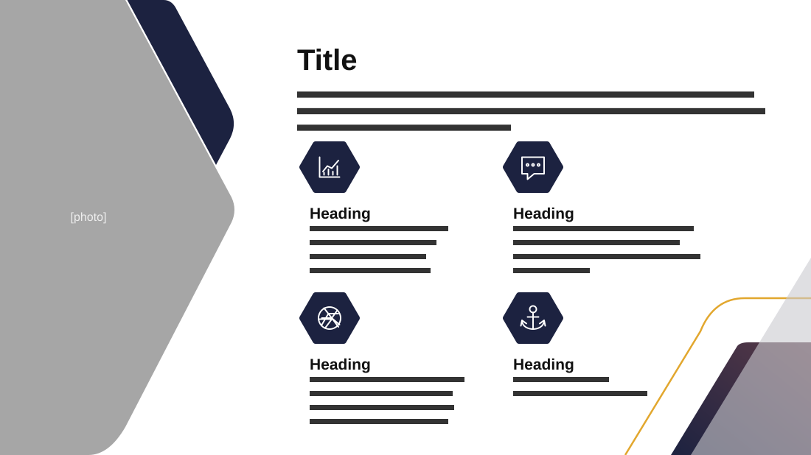

# Project Overview

**Use for:** a project overview: one intro and four key aspects.

**Layout.** Left: a photo, about a quarter of the width, cut by a rounded chevron pointing right, its tip near the middle of the height, with a navy band along its upper edge. Right: the title, a three-line intro and a two-by-two grid of items, each a dark hexagon icon over a bold heading and two to four lines. A thin gold curve, a translucent grey triangle and a dark rounded shape decorate the bottom-right corner.

**Style.** White background, dark navy hexagons and shapes, one gold accent line.

**Density.** Medium: about 110 words.

