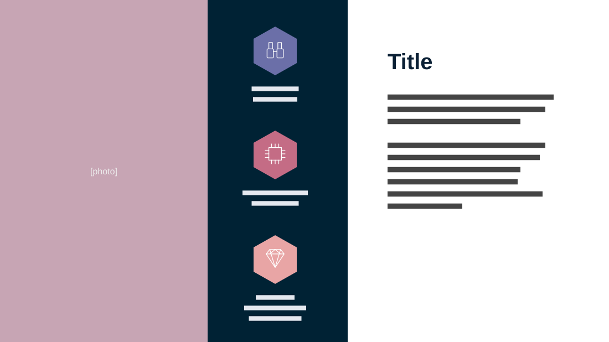

# Mission

**Use for:** a mission, vision or values statement, with three supporting values.

**Layout.** Three full-height vertical panels. Left, about a third: a photo. Centre, a narrow dark strip: three hexagons with a line icon, stacked and evenly spaced, each over a short centred caption. Right, the widest: the title and two short paragraphs, left-aligned in the upper part, leaving the bottom empty.

**Style.** Dark navy strip, hexagons in muted violet, rose and blush, white right panel with navy text.

**Density.** Low: about 80 words.

