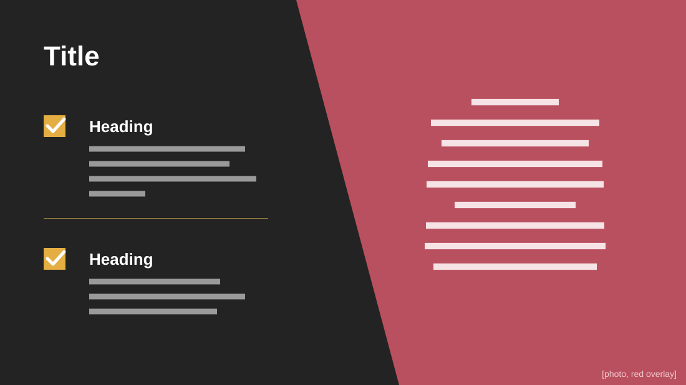

# Problem Slide

**Use for:** a pitch's problem slide: two problems on the left, the takeaway statement on the right.

**Layout.** A diagonal edge, from x≈475 at the top to x≈640 at the bottom, splits the slide. Left of it, a near-black panel holds the title and two problems, each a check mark on a gold square beside a bold heading and three or four lines, with a thin rule between them. Right of it, a full-height photo under a red overlay, with one statement of about nine centred lines.

**Style.** Near-black panel, red-to-crimson overlay, gold check squares, a heavy white title, light body text.

**Density.** Low: about 80 words.

