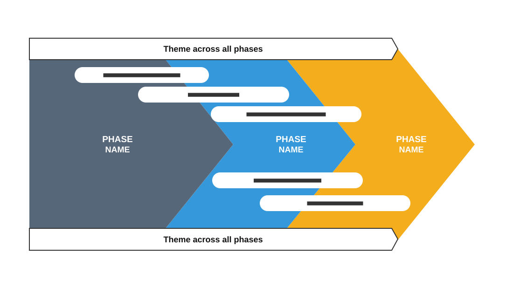

# Change Management Model: Transition Phases

**Use for:** a change or transition model: from the current state, through a transition, to the target state.

**Layout.** No title: the diagram fills the slide. Three overlapping chevrons, left to right, the last one a large arrow whose tip reaches past the others, each with its phase name in white capitals. Five white pills lie across the chevrons, staggered left to right, three above the phase names and two below, each spanning the phases its activity covers. An outlined arrow bar runs along the top and another along the bottom, each labelled with a theme that spans every phase.

**Style.** White background; slate, sky blue and amber chevrons; white pills with dark text; dark outlines on the bars.

**Density.** Low: about 40 words.

