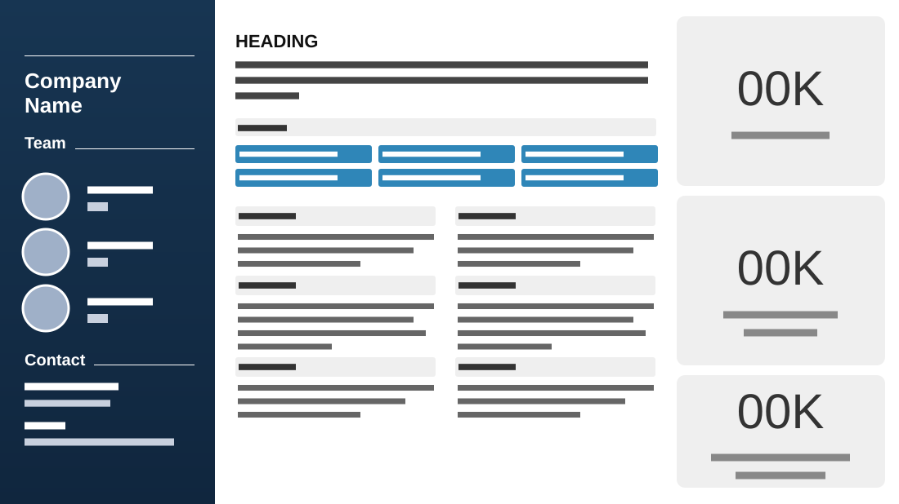

# Company Overview

**Use for:** a company or team one-pager that fits everything on one dense slide.

**Layout.** Three columns. A full-height navy sidebar: the company name, a "Team" heading with three round portraits each beside a name and role, and a "Contact" heading with a phone number and an email. The centre: an uppercase heading, a three-line overview, a grey "Services" bar over six blue chips in two rows, then six small sections in two columns, each a grey heading bar over three or four lines. The right: three tall grey rounded tiles, each a very large light number over a short label.

**Style.** Navy sidebar with white text, white centre, light grey bars and tiles, mid-blue chips.

**Density.** High: about 220 words.

