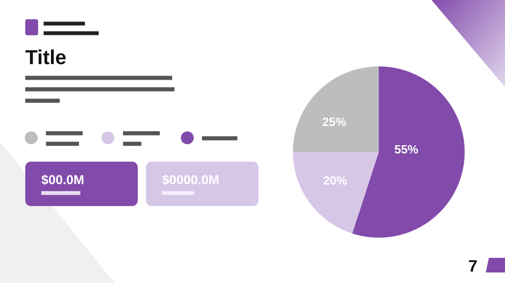

# Financial Info

**Use for:** a financial overview: a breakdown in three parts and two headline figures.

**Layout.** Left half, top to bottom: a small logo with the company name, a large title, a three-line intro, a one-row legend of three coloured dots with their labels, and two rounded KPI tiles side by side. Right half: a large pie chart with the percentages inside its slices. A violet triangle in the top-right corner, a pale grey one in the bottom-left, a large page number with a violet tab at bottom right.

**Style.** White background, violet, lavender and grey, black title.

**Density.** Low: about 50 words.

