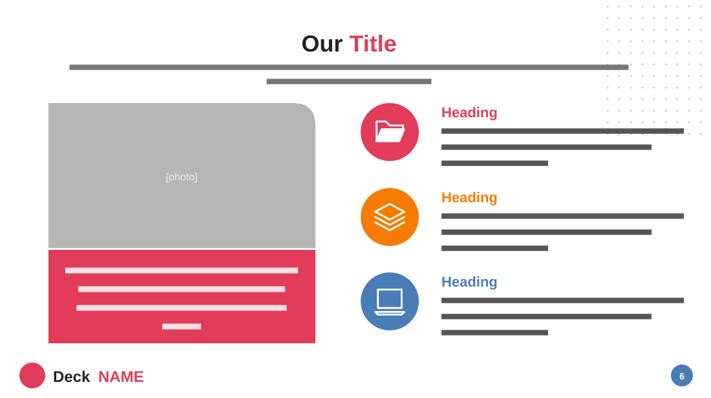

# Our Services

**Use for:** what a team or company offers: three services beside a photo and a quotation.

**Layout.** A centred two-tone title (first word dark, second red) over a two-line centred subtitle. Left: a photo with a rounded top-right corner, directly above a red box with a centred italic quote. Right: three rows, each a filled coloured circle with a white icon beside a coloured heading and three lines. A footer with a small logo and the deck's name at left and a round page badge at right; a dot texture fills the top-right corner.

**Style.** White background; red, orange and steel blue for the three services; dark grey text.

**Density.** Medium: about 100 words.

