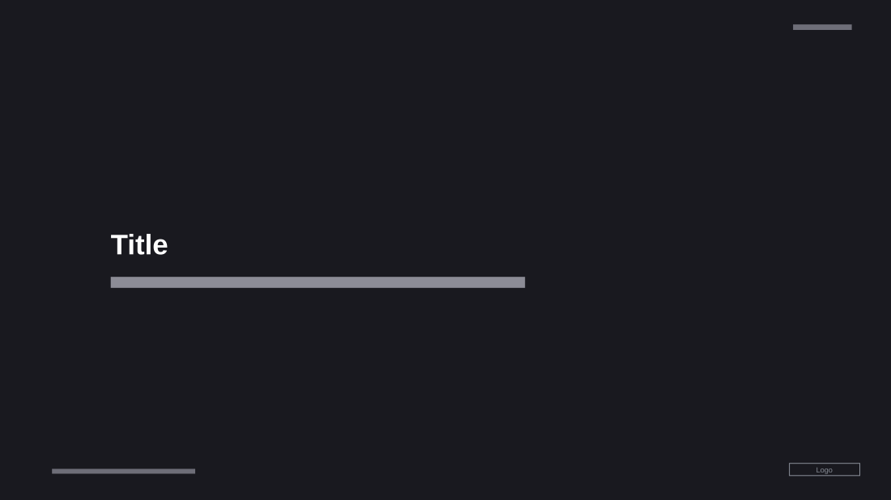

# Dark Title Cover

**Use for:** the cover of a corporate deck: a project or programme name and a one-line description of it.

**Layout.** Almost empty. A bold title and a one-line subtitle under it sit left-aligned, about an eighth of the width in, just below the vertical middle. The date is small at the top right, a one-line confidentiality footer at the bottom left and the logo at the bottom right.

**Style.** Near-black background, white title, light grey subtitle, dim grey date and footer, a white logo.

**Density.** Very light: about 15 words.

