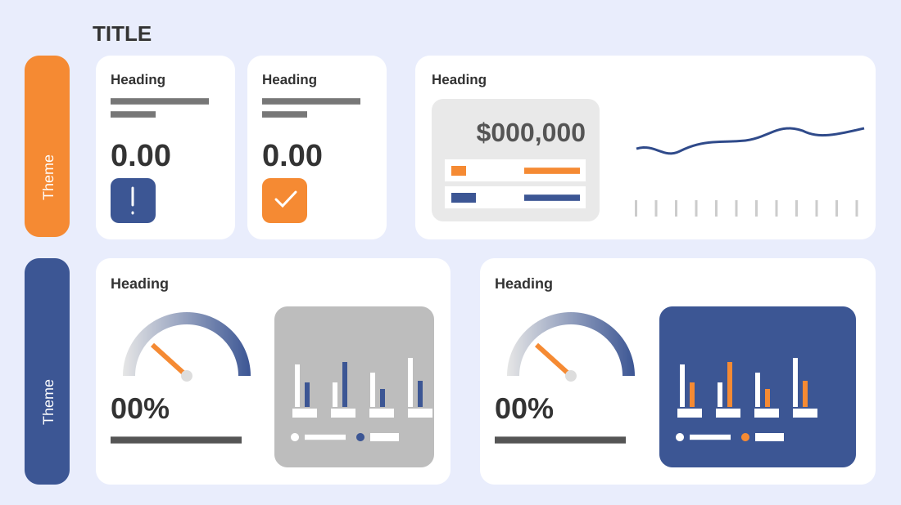

# Financial Snapshot

**Use for:** a snapshot of several metrics at once, grouped in two themes, with small charts.

**Layout.** A title at top left, then two rows of white rounded cards, each row labelled by a tall pill on the left with its theme written vertically. Top row: two narrow cards, each a heading, a two-line explanation, a big figure and a status badge; then a wide card with a big figure, an in/out breakdown and a line chart over twelve years. Bottom row: two wide cards, each a heading, a half-circle gauge with a percentage and caption, and a small grouped bar chart (projected against actual) on a coloured panel.

**Style.** Pale lavender background, white cards, navy and orange as the two accents throughout.

**Density.** High: about 70 words with five charts.

