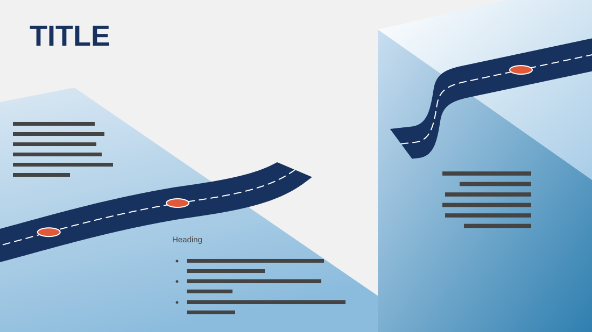

# Gap Analysis

**Use for:** a gap analysis: where we are, where we want to be and what lies between.

**Layout.** A large uppercase title at top left. A low plane at the left carries a road climbing to the right and stopping short; a raised block at the right carries the road again at a higher level, the drop between them standing for the gap. The current state, a short paragraph, sits above the low road on the left; the gaps, a heading with three bullets, sit below it in the middle; the target state, a right-aligned paragraph, sits on the raised block.

**Style.** Light grey with pale-to-mid blue planes, a navy road with white dashes and orange markers, navy title.

**Density.** Medium: about 90 words.

