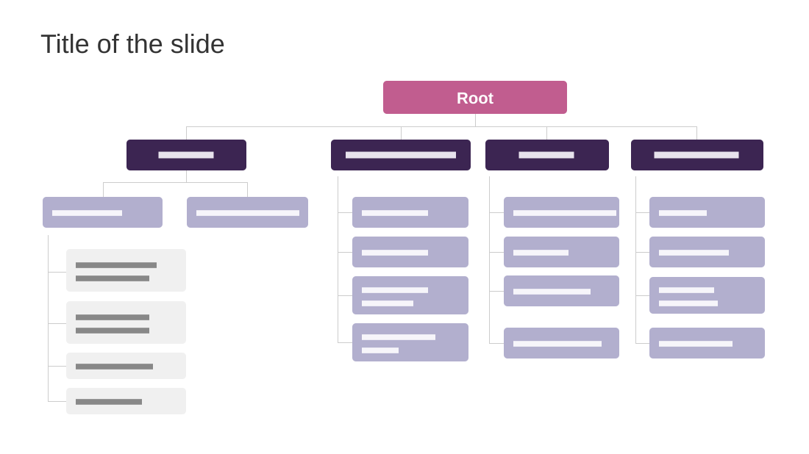

# Key Segments of the Industry

**Use for:** the segments of a market, an organisation chart, or any breakdown two or three levels deep.

**Layout.** A title at top left. A tree: a root box right of centre, joined by thin connectors to four branch boxes in a row. Under the first branch, two leaves side by side, and under the first leaf four sub-leaves on a bracket line. Under each other branch, four leaves stacked on a bracket line.

**Style.** White background, magenta root, deep purple branches, lavender leaves, light grey sub-leaves, thin grey connectors.

**Density.** Medium: about 60 words, all in labels.

