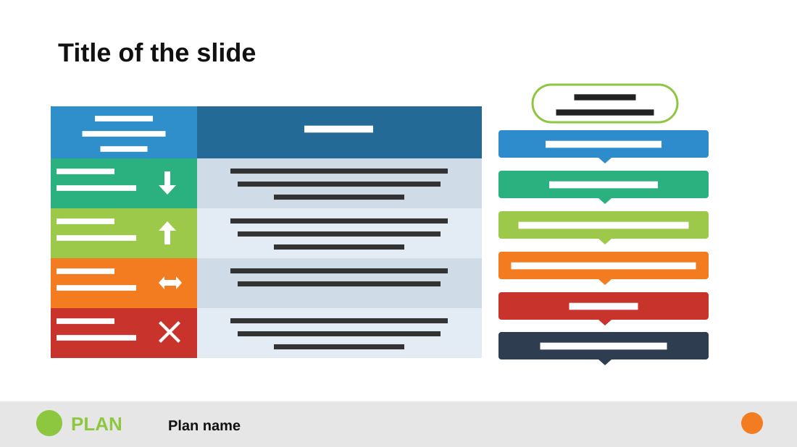

# Sharing Information in Change Management

**Use for:** types of something explained in a table, beside the chain they move through.

**Layout.** A heavy title. Left, a two-column table: a header and four rows, each a coloured label cell with an icon and a description cell. Right, a rounded outlined label on top, then six stacked coloured bars, each pointing down to the next. A grey footer band with a logo, the plan's name and a round page badge.

**Style.** White background, blue table header, green, lime, orange and red label cells, the bars in a matching sequence ending in dark slate.

**Density.** Medium: about 110 words.

