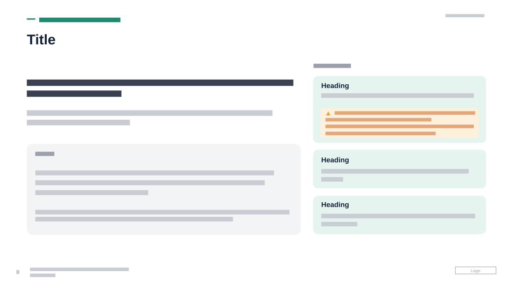

# Intro with Goal and Priorities

**Use for:** introducing a programme or initiative: what it is, its goal, and the three priorities it serves, with one priority's risk called out.

**Layout.** A small uppercase eyebrow with a short teal rule in front of it, then a large title, both at top left. The left column, about 55% of the width, holds a bold two-line lead statement, a short paragraph, then a rounded grey panel with a small "goal" label and two paragraphs. The right column has a small uppercase label over three stacked rounded mint cards, each a bold heading and one or two lines. The first card is taller and holds an amber callout with a warning icon and three or four lines that quantify a problem. Date at top right, page number, footer and logo at the bottom.

**Style.** White background, navy headings, dark grey text, teal eyebrow, light grey and mint cards with no borders, an amber callout with orange text, small grey uppercase labels.

**Density.** Medium-heavy: about 160 words.

