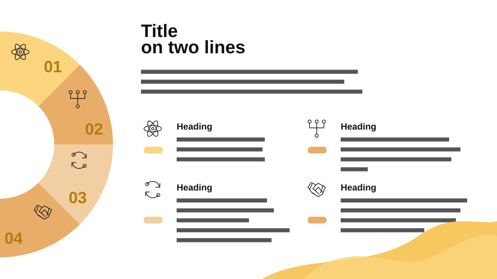

# Market Opportunities

**Use for:** four opportunities, priorities or pillars, introduced by one paragraph.

**Layout.** A thick half ring is cut off by the left edge, centred near (0, 320): four segments from top to bottom, numbered 01 to 04, each with a line icon. To its right: the title on two lines, a three-line intro, then a two-by-two grid of items, each a line icon above a small pill in its ring segment's colour, beside a bold heading and three to five lines. A soft yellow wave fills the bottom-right corner.

**Style.** White background, the ring in four shades from pale yellow to amber, matching pills, black text.

**Density.** Medium: about 120 words.

