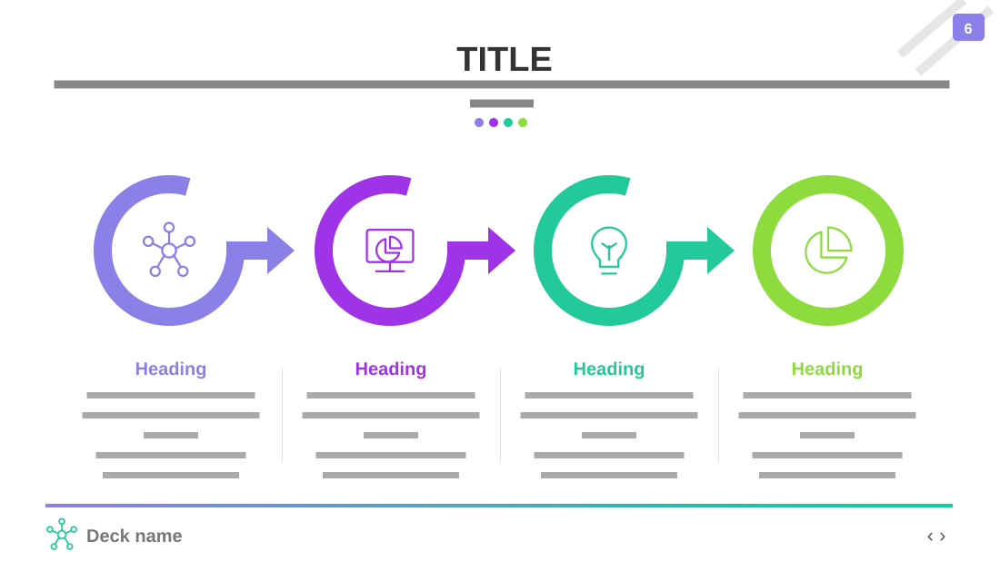

# Market Segmentation

**Use for:** four parallel segments or categories, each with a description and a target.

**Layout.** A centred uppercase title over a two-line centred subtitle and four coloured dots. Across the middle, four large rings with an icon inside; each of the first three opens at its top right and ends in an arrow pointing to the next ring. Under each ring, a centred column: a coloured heading and about five grey lines ending in a bold "Target:" line, with thin dividers between the columns. A footer: a gradient line, a small logo with the deck's name at left, navigation arrows at right; a page badge sits at top right.

**Style.** White background; one colour per segment (violet, purple, teal, lime) for its ring, arrow and heading; grey body text.

**Density.** Medium: about 110 words.

