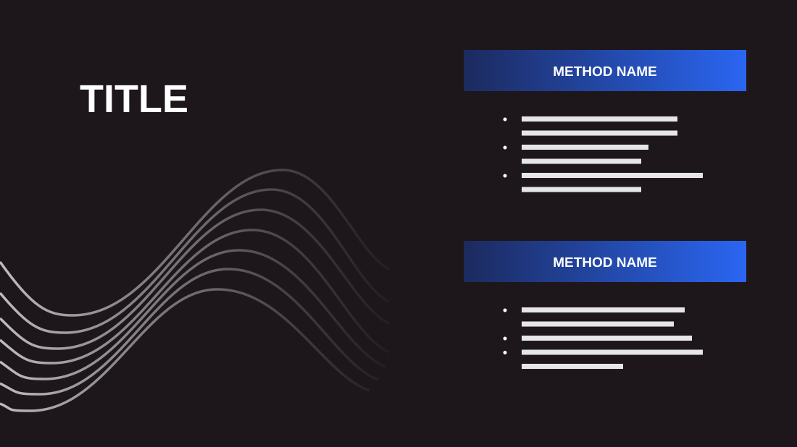

# Methodology

**Use for:** two approaches, methods or options, each with a few bullets.

**Layout.** Left: a very large uppercase title, with a bundle of flowing curved lines rising from the bottom-left corner below it. Right: two blocks, each a gradient header bar with its name in capitals, then three bullets.

**Style.** Near-black background, white text, grey line art, navy-to-bright-blue gradient bars.

**Density.** Low: about 70 words.

