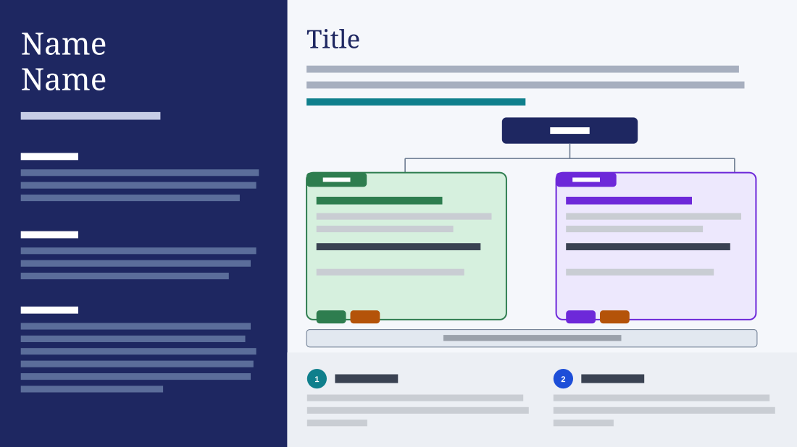

# Profile Sidebar with Team Structure

**Use for:** introducing yourself and a proposal on one slide, such as an interview case or a new leader's first plan: who you are and what you stand for on the left, the teams you propose on the right.

**Layout.** A dark panel fills the left 36% from top to bottom: a large two-line name, a letter-spaced role under it, then three small bold labels, each over a short paragraph, the last a bulleted list. On the right a large title, two lines of intro and a short bold coloured note. Under them an org chart: a dark rounded node at the top, joined by lines to two equal rounded cards side by side. Each card has a small uppercase tag on its top edge (its kind of team), a coloured heading, two lines of text, a bold lead-in line and two small role pills on its bottom edge. A thin full-width band under the cards names the shared functions. A pale band across the bottom holds two numbered points side by side, each a coloured circle with its number, a heading beside it and a paragraph of three lines. No date, footer or logo.

**Style.** Navy left panel with white headings and pale blue-grey text, a serif display face for the name and titles. Off-white right side, navy title and node, grey intro, teal note. One card pale green with a dark green border, tag and heading, the other pale lavender with purple; the pills dark in the card's colour and orange. A light grey band with a slate border, a pale grey bottom band, teal and blue number circles.

**Density.** Heavy: about 300 words.

