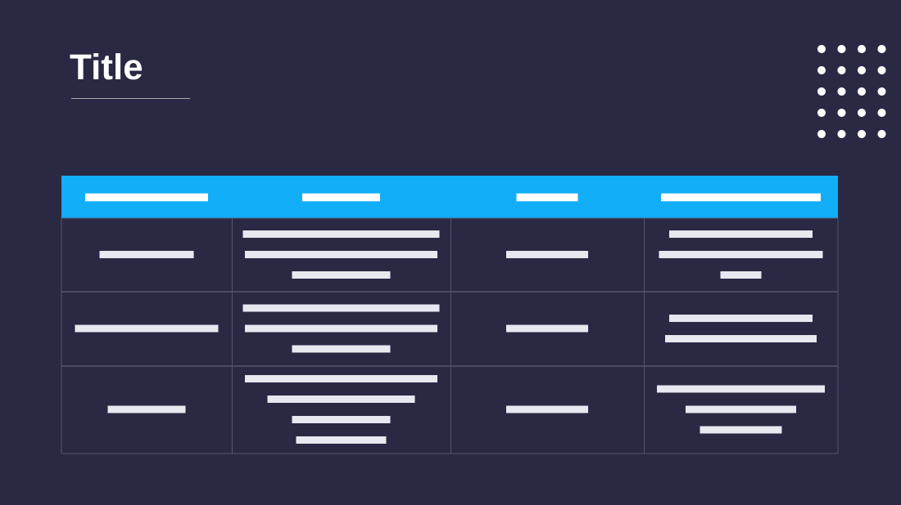

# Project Deliverables

**Use for:** deliverables, milestones or any list of items with a description, a date and acceptance criteria.

**Layout.** A large title at top left with a short rule under it, a four-by-five grid of dots at top right, then a wide four-column table (name, description, due date, acceptance criteria) of a header and three rows, all text centred.

**Style.** Dark indigo background, bright sky-blue table header, white text, thin muted cell borders.

**Density.** Medium: about 100 words.

