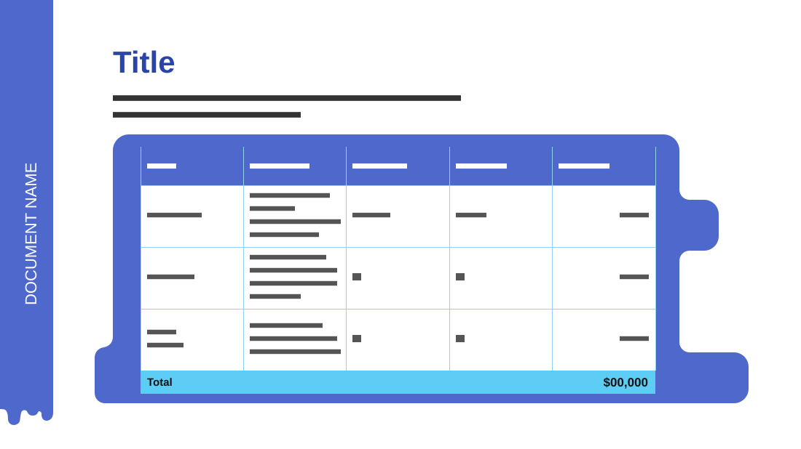

# Cost Estimate

**Use for:** a quote, budget or cost breakdown with a total.

**Layout.** A narrow vertical band on the left edge carries the document's name, rotated. To its right: a large title, a two-line intro, then a five-column table (item, description, units, unit price, total) of a header, three rows and a highlighted total row, set on a large rounded blue frame with notches on its left and right sides.

**Style.** White background, cornflower blue band, title and frame, white cells with thin light-blue borders, a sky-blue total row.

**Density.** Medium: about 70 words.

