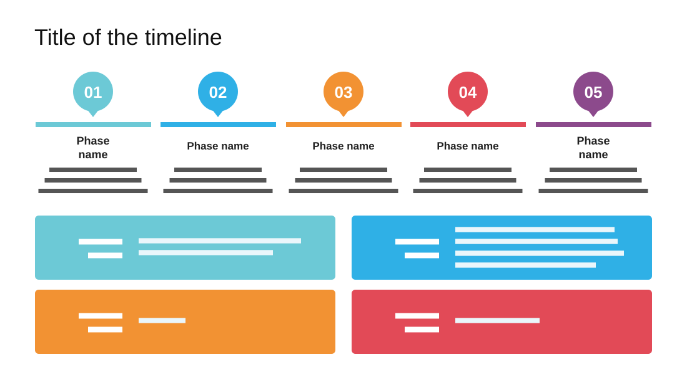

# Software Project Proposal Timeline

**Use for:** a project proposal: the phases in order, with the project's key facts below.

**Layout.** A title at top left. Below, five equal columns, each a numbered map pin (01 to 05) over a coloured bar, a centred bold phase name on one or two lines and three centred lines. In the lower half, a two-by-two grid of solid coloured cards, each a bold uppercase label beside its value.

**Style.** White background; one colour per step (teal, sky, orange, red, plum), reused for the cards.

**Density.** Medium: about 130 words.

