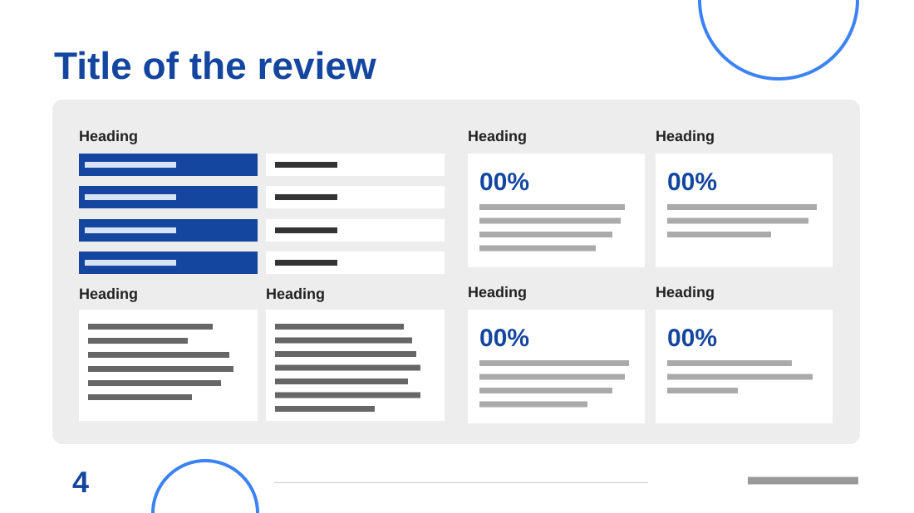

# Quarterly Performance Review

**Use for:** a performance review or scorecard: who and when, two comments and four scores.

**Layout.** A large title across the top, then a light grey rounded panel. Its left half: a heading over a four-row table of blue label cells and white value cells, then two comment boxes side by side under their headings. Its right half: a two-by-two grid of white score tiles under their headings, each a big blue percentage and three or four grey lines. A footer: a large page number, a thin rule and the organisation's name. Blue outline circles are cut by the top-right corner and the bottom edge.

**Style.** White slide, light grey panel, royal blue title, labels and percentages, grey body text.

**Density.** High: about 170 words.

