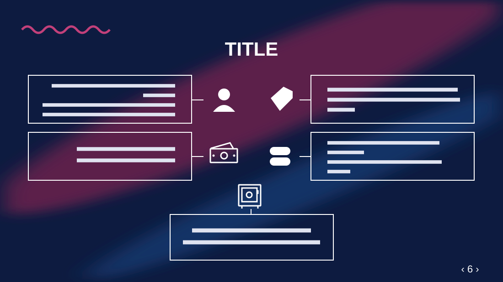

# Revenue Model

**Use for:** a business or revenue model: five facts, each in its own box, around a central column of icons.

**Layout.** A small wave at top left and a centred uppercase title. Below, two rows of two outlined boxes, mirrored: each box is joined by a short line to a white icon, and the two icons of a row sit side by side in the middle. Left boxes are right-aligned, right boxes left-aligned. A fifth box is centred at the bottom, joined by a short vertical line to an icon above it. A page number between arrows sits bottom right.

**Style.** Deep navy background with blurred red and blue sweeps, thin white box outlines, white text and icons.

**Density.** Medium: about 90 words.

