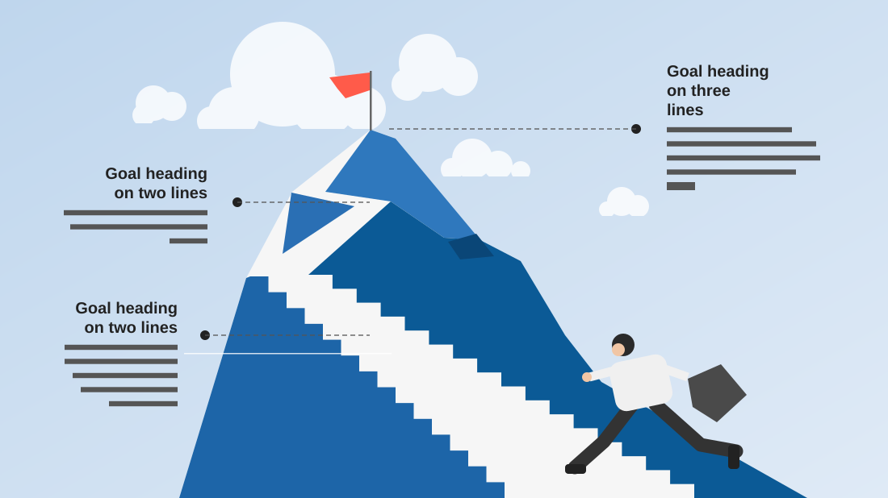

# Sales Goals

**Use for:** goals or targets presented as a climb towards a summit.

**Layout.** A full-bleed illustration of a mountain with a staircase and a figure running up it, a flag on the summit. Three goals sit at different heights, two on the left (right-aligned) and one at top right (left-aligned), each a bold heading of two or three lines with its figure in it and three to five lines of text, joined to the mountain by a dashed leader line ending in a dot.

**Style.** Pale sky blue with white clouds, a deep blue mountain, white stairs, dark text.

**Density.** Medium: about 80 words.

