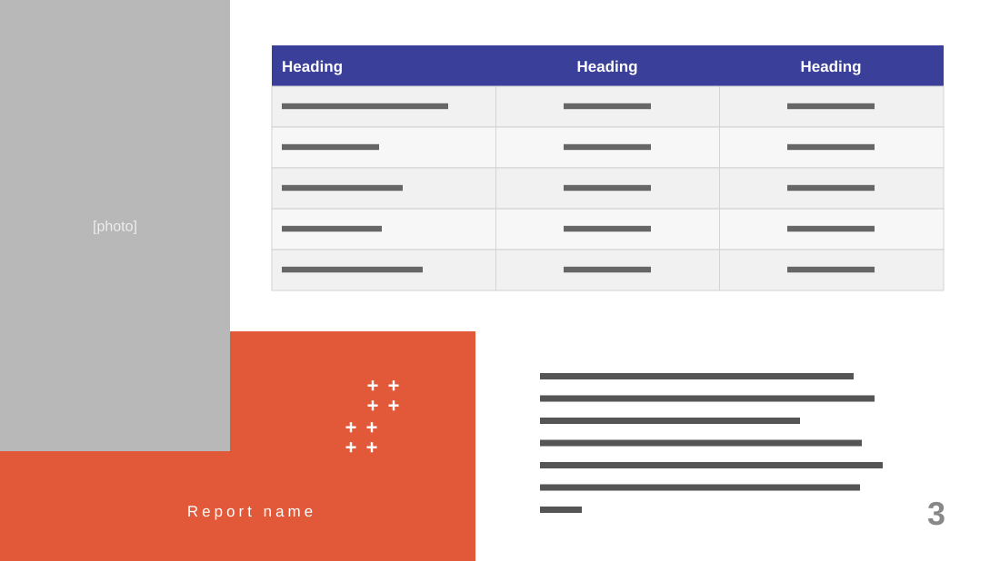

# Semester Progress Report

**Use for:** a progress report comparing targets across periods, with one paragraph of commentary.

**Layout.** A photo fills the top-left corner, about a quarter of the width and most of the height. To its right, a three-column table: an indigo header and five rows of an item and two period targets. An orange block fills the bottom left, overlapping the photo's bottom-right corner, with a small pattern of plus signs and the report's name in spaced capitals. The commentary paragraph sits bottom right, with a large grey page number in the corner.

**Style.** White background, indigo table header, alternating light grey rows, an orange-red block.

**Density.** Medium: about 110 words.

