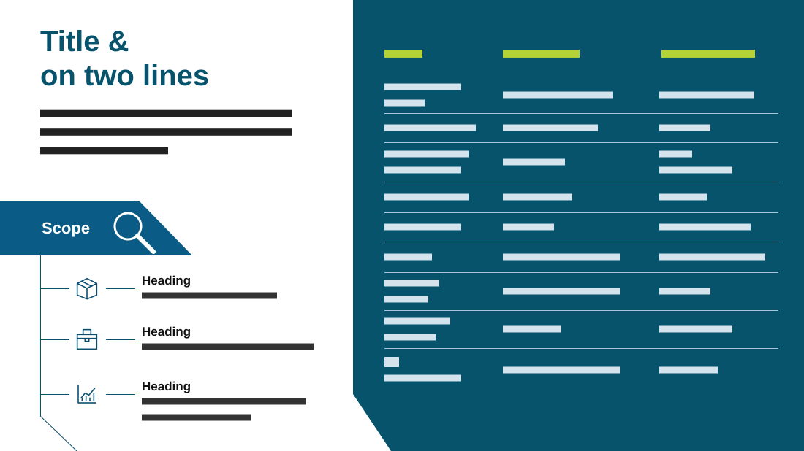

# Scope & Inventory

**Use for:** a scope with a few areas of work, next to an inventory or register in a table.

**Layout.** Left: a two-line title, a three-line intro, then a dark tab labelled "Scope" with a magnifier icon, from which a vertical line runs down with three branches, each an outline icon beside a bold heading and one or two lines. Right: a dark panel, its bottom-left corner cut diagonally, holding a three-column table of nine rows on thin rules under a lime header.

**Style.** White left, deep teal panel, teal title, lime table header, light text on the panel.

**Density.** High: about 130 words.

