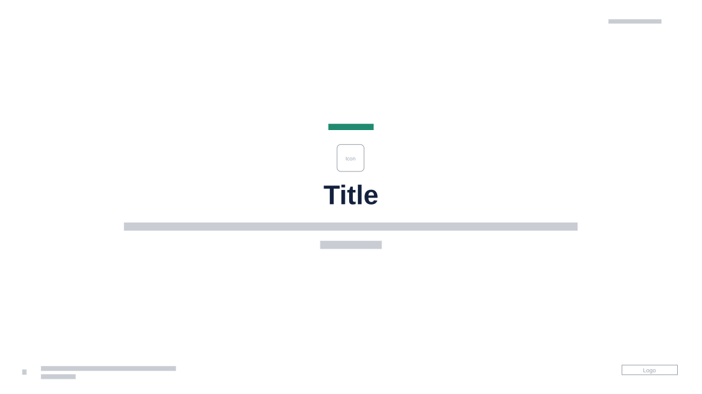

# Section Divider with Icon

**Use for:** opening a section of a deck: its name and a sentence on what it covers.

**Layout.** Everything centred in the middle of the slide: a small uppercase teal kicker ("section"), a small icon, a very large bold title, then one or two lines of subtitle. Date at top right, page number, footer and logo at the bottom.

**Style.** White background, navy title, grey subtitle, teal kicker, a single colourful emoji-style icon.

**Density.** Very light: about 20 words.

