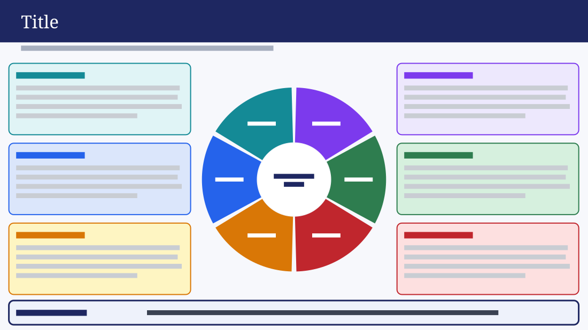

# Six-Theme Wheel with Cards

**Use for:** six themes that together make one whole, such as the pillars of a team's culture or an operating model, each with a paragraph, plus the one thing they all rest on.

**Layout.** A full-width dark header band holds a large title, with a one-line subtitle under it. A wheel of six equal segments with gaps between them, around a white centre holding a two-line label, sits in the middle of the slide. Three cards on each side, equal and stacked, fill the left and right thirds, each a heading and a paragraph of four lines; each card matches a segment, whose short label sits in white on it, in the order of the wheel. A full-width card along the bottom, with a thicker border, holds a label on the left and one line of text. No date, footer or logo.

**Style.** Navy header with a white serif title, an off-white background, a grey subtitle. Each card is pale with a border and heading in its segment's colour: teal, blue, orange, purple, green and red. Navy centre label, a pale blue-grey bottom card with a navy border and label.

**Density.** Heavy: about 300 words.

