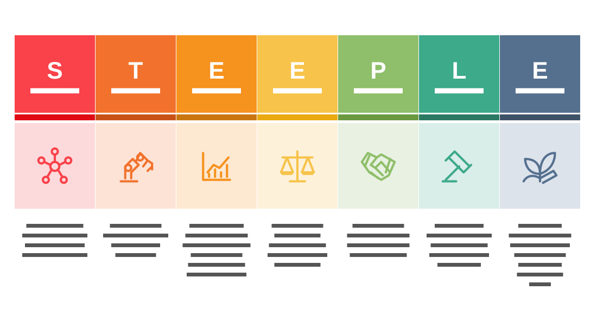

# STEEPLE Analysis

**Use for:** a framework spelled by an acronym (PESTLE, SWOT, STEEPLE), one column per letter.

**Layout.** No separate title: the acronym is the title. Seven equal columns across the slide, each a solid header cell with a big letter and its word, a thin darker band, a pale cell with a large icon, then four to seven centred lines below.

**Style.** White background; a spectrum from red through orange, yellow and green to slate, one colour per column, its icon cell a pale tint of it.

**Density.** Medium: about 140 words.

