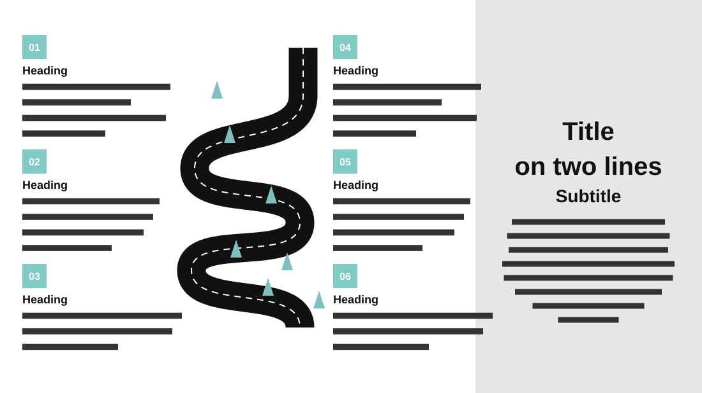

# Success Story Roadmap

**Use for:** a journey or success story told in six steps.

**Layout.** A winding road runs top to bottom left of centre. Three numbered steps are stacked on its left and three on its right, each a small numbered square, a bold heading and three or four lines. A grey panel fills the right third, with a large centred title, a subtitle and a short closing paragraph.

**Style.** White background, a black road with white dashes and small teal trees, teal number squares, a light grey panel.

**Density.** Medium: about 130 words.

