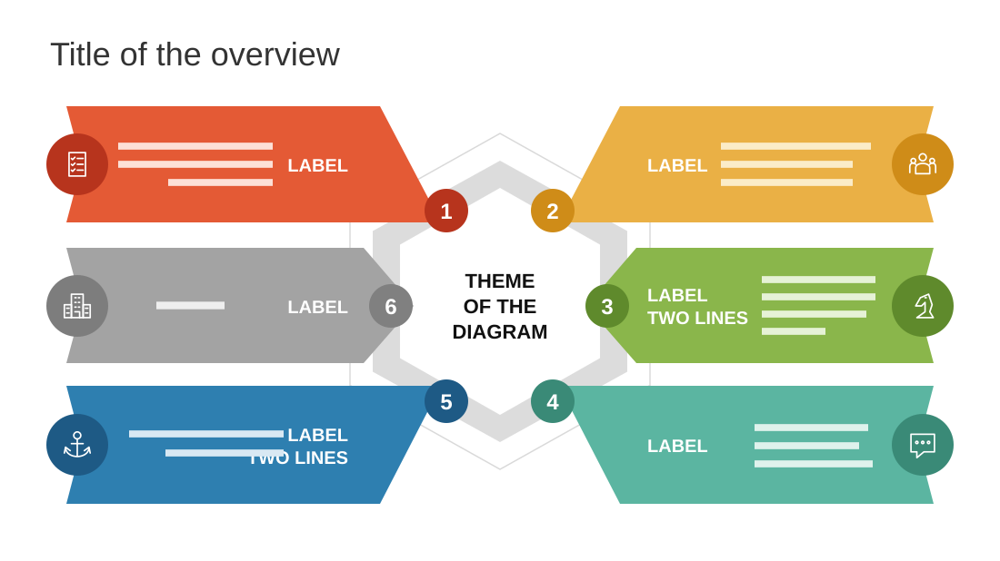

# Digital Marketing Course Overview

**Use for:** a plan or overview with six components around one central theme.

**Layout.** A title at top left. In the centre, a hexagon hub with the theme in capitals, inside a grey hexagonal band and a thin outline. Six wide arrow-shaped bands point at the hub, three from each side, with numbered circles where they meet it. Each band holds a round icon at its outer end, a bold uppercase label next to the hub and two to four lines of detail.

**Style.** White background; one colour per band (orange, amber, grey, green, blue, teal), darker for its icon and number.

**Density.** Medium: about 80 words.

