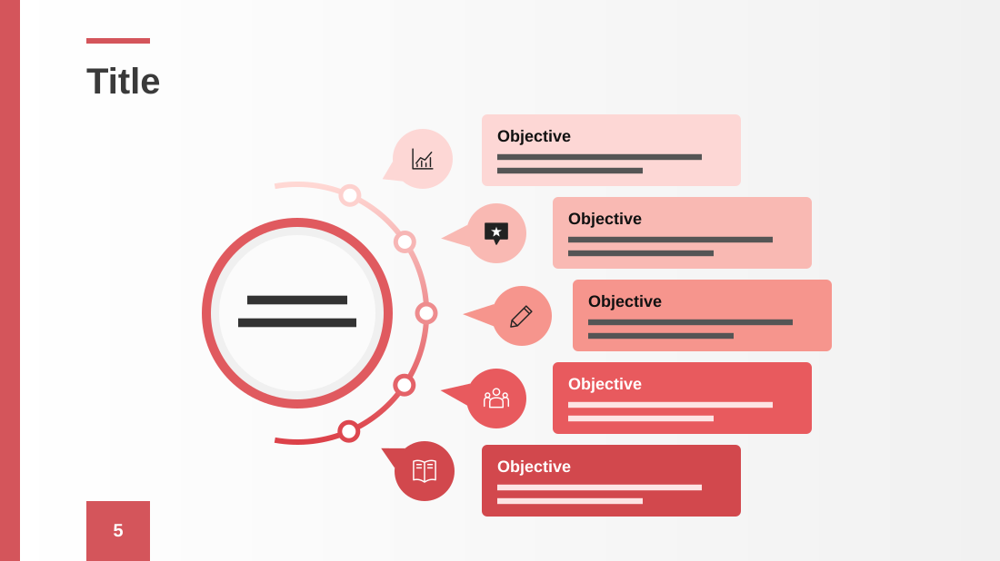

# Training Objectives Slide

**Use for:** objectives, goals or benefits, five of them, around one central idea.

**Layout.** A title with a short accent bar above it. Left of centre, a large ringed circle with a two-line summary. An arc curves around its right side with five small nodes; beside each node, a round icon bubble points at the arc, and a rounded card with a bold heading and two lines sits to its right. The cards step out and back in to follow the arc, their colour deepening from top to bottom. A thin accent band runs down the left edge, and a page-number tab sits at bottom left.

**Style.** Light grey background, coral red accents, cards from pale pink to deep red.

**Density.** Medium: about 90 words.

