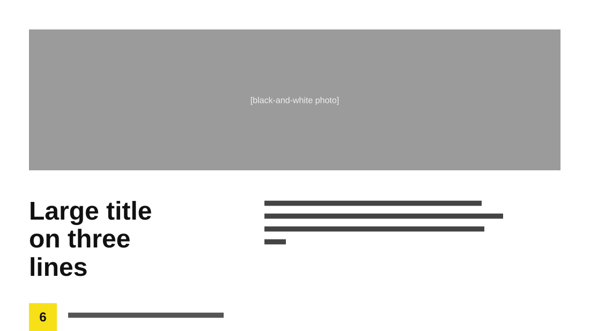

# Understanding Leadership Styles

**Use for:** opening a unit, chapter or topic: one big title and a short description.

**Layout.** A wide photo banner across the upper half. Below it, a very large title over three lines on the left and a four-line paragraph on the right. A footer with the page number in a bright yellow square and the course name.

**Style.** White background, black-and-white photo, heavy black title, one bright yellow accent.

**Density.** Low: about 45 words.

