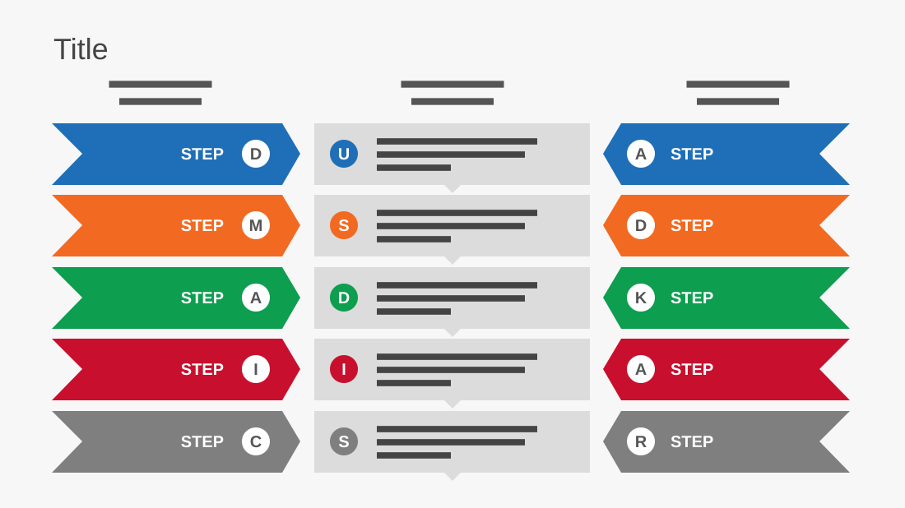

# Change Management Methodologies

**Use for:** comparing two models step by step, with what they share in a middle column.

**Layout.** A title, then three columns with small centred two-line headings. Five aligned rows: on the left, an arrow-shaped band pointing right, with a step name and its initial in a white circle; in the middle, a grey card with a coloured initial circle and three lines, a small notch pointing down to the next card; on the right, an arrow-shaped band pointing left, with an initial circle and a step name.

**Style.** Light grey background; one colour per row (blue, orange, green, red, grey) for its two bands and its middle circle.

**Density.** Medium: about 110 words.

