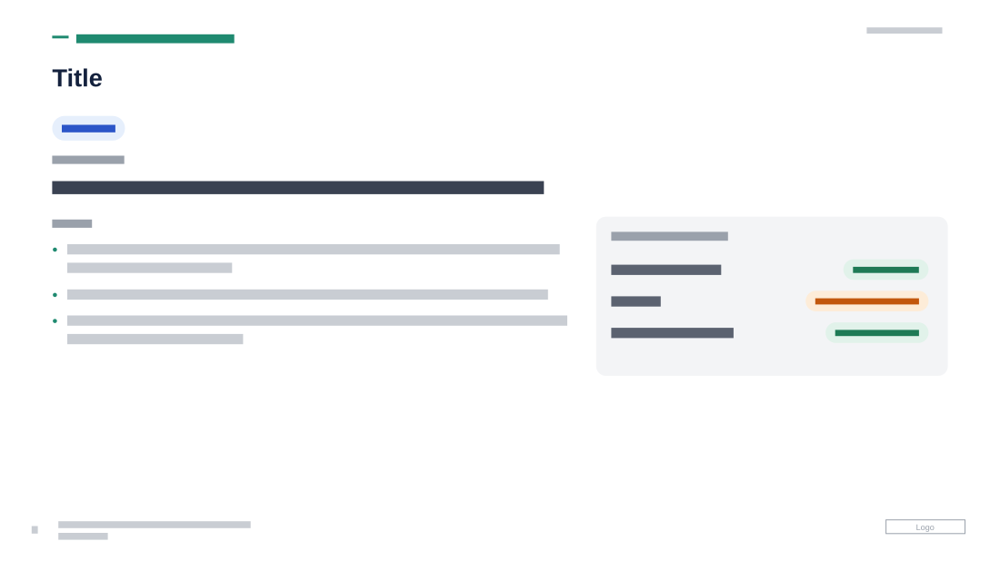

# Workstream Detail with Status Panel

**Use for:** one workstream or project in detail: what it links to, its objective, the work and the current status of each part.

**Layout.** An uppercase eyebrow with a short teal rule ("n of 6" fits there), then a large title, at top left. Under them one or more small rounded tag pills, a small "objective" label over one larger line, and a small "work" label over a bulleted list, some bullets opening with a bold lead-in, in the left 55%. To the right of the list a rounded grey status panel holds a small label and two or three rows, each an item on the left and a rounded status badge on the right, coloured by state. The bottom third is left empty. Date at top right, page number, footer and logo at the bottom.

**Style.** White background, navy title, dark grey text, teal eyebrow and bullet dots, pale blue pills with blue text, a light grey panel, badges in pale green, pale orange or pale blue with matching dark text and a dot.

**Density.** Medium: about 90 words.

