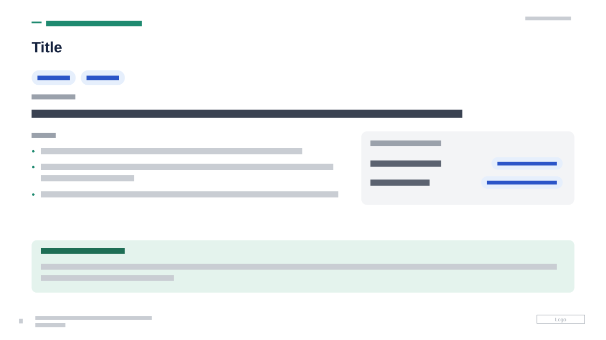

# Workstream Detail with Capability Band

**Use for:** one workstream or project in detail, as in the status-panel version, with what it delivers described in a band at the bottom.

**Layout.** As the workstream detail with status panel: eyebrow and title, tag pills, an "objective" label over one line that can run the full width, a "work" label over two or three bullets on the left and a grey status panel with two rows on the right; an optional italic flow line (one step to the next with arrows), or a note under a status row, fits in the space. Across the bottom, a full-width rounded mint band holds a small uppercase teal label naming the deliverable and a two-line description. Date at top right, page number, footer and logo at the bottom.

**Style.** White background, navy title, dark grey text, teal eyebrow and bullet dots, pale blue pills, a light grey panel with coloured status badges, a mint band with a dark teal label.

**Density.** Medium: about 110 words.

