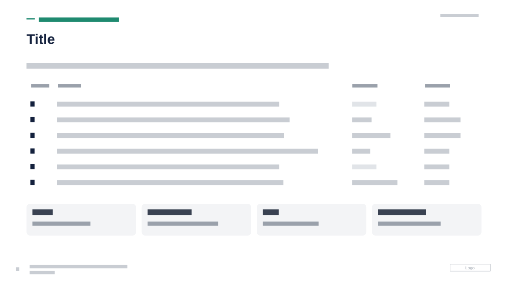

# Workstream Table with Capability Chips

**Use for:** an overview of several workstreams or projects, each with its objective, what it delivers and what it links to, plus a summary of the main deliverables.

**Layout.** An uppercase eyebrow with a short teal rule, a large title and a one-line lead, at top left. Then a borderless four-column table: a header of small grey uppercase labels and six rows of a bold letter, a one-line objective that takes most of the width, a deliverable name (lighter when there is none yet) and a short reference. Under the table, a row of four equal rounded grey chips, each a bold name and a one-line description. Date at top right, page number, footer and logo at the bottom.

**Style.** White background, navy title and row letters, dark grey row text, lighter grey for empty cells, light grey chips, teal eyebrow.

**Density.** Medium: about 130 words.

